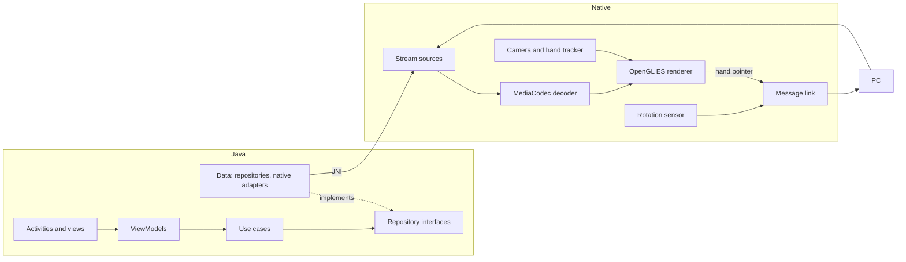

# Architecture

How the app is put together. For building and testing, see [Development](development.md). The
wire protocol shared with the PC is documented once, in Gazeora's
[stream format](https://github.com/Gazeora/Gazeora/blob/master/docs/stream-format.md).

## Overview

The app has two halves:

- **Java (`app/src/main/java`)**: the screens, permissions, discovery list, USB accessory
  handling, touch interpretation and decoder choice. MVVM with Clean Architecture, wired by
  Hilt.
- **C++ (`app/src/main/cpp`)**: the network client, protocols, video decoding with NDK
  `MediaCodec`, OpenGL ES rendering, hand tracking, head tracking, and the input messages sent
  to the PC. The Java code reaches it only through adapters over JNI.



## Java layers

```text
Presentation  ──▶  Domain  ◀──  Data
(Activity, ViewModel,   (use cases, models,    (repositories, native
 UiState, views)         repository interfaces) adapters, mappers)
```

- **Presentation.** Activities only bind views and forward events. ViewModels expose
  `LiveData<UiState>`, and UI states draw themselves (State pattern). One-off events go through
  an `EventQueue`.
- **Domain.** Plain Java without Android types. Use cases have a single `execute()` method.
- **Data.** Implements the domain interfaces. Native code sits behind adapters
  (`NativePlayer`, `NativeDiscovery`, `NativeUsbLink`), so the rest of the app never calls JNI.

### Project structure

```text
app/src/main/java/com/gazeora/gazeora/
├── core/
│   ├── device/        # device information, emulator detection
│   ├── di/            # app-wide Hilt modules
│   ├── discovery/     # finding PCs on the network (data + domain)
│   ├── hands/         # loads the hand tracker's models as the app starts
│   ├── nativebridge/  # loads the native library
│   ├── network/       # the local network permission
│   ├── stream/        # StreamProtocol, StreamTarget, StreamDefaults
│   ├── ui/            # shared views and UI helpers
│   └── usb/           # USB accessory connection
├── feature/
│   ├── connect/       # home screen: PC list, manual entry, About
│   │   └── data/  domain/  presentation/  di/
│   └── player/        # full-screen player, touch, decoder choice
│       └── data/  domain/  presentation/  di/
└── GazeoraApplication.java
```

Unit tests in `app/src/test/java` use the same package layout.

## Native client

| Folder or file | Responsibility |
|---|---|
| `protocols/` | Pure protocol code without Android dependencies: RTSP messages, RTP depacketizing, MPEG-TS demuxing, Annex B, GZF1 framing and frame assembly, view info, discovery replies, and the pointer, head pose and camera status messages |
| `sources/` | One stream source per protocol (`rtsp_source`, `http_source`, `udp_source`), plus the shared USB link (`usb_link`) |
| `links/` | How input messages reach the PC: UDP datagrams to port 8557 for network protocols, or the USB link |
| `pointer/` | Sends touches and the hand pointer's actions over a link |
| `head/` | The rotation sensor (`rotation_sensor`), the head's orientation in the viewer, and the head pose sender |
| `hands/` | The back camera and its light gate; the hand models (LiteRT) and tracker; following the viewer's own hands; the hand pointer; the hand skeleton and the rigged hand model; and their geometry |
| `gl/` | Decoder and camera buffers as textures, and releasing them once drawn |
| `shaders/` | GLSL: `video.frag` for the stream flat or for a VR viewer, with the hand pointer's cursor; `hand.vert` and `hand.frag` for the drawn hands |
| `player.*` | Ties a source to the decoder, renderer, input links and head tracker |
| `video_decoder.*`, `video_renderer.*` | NDK `MediaCodec` decoding, and drawing with OpenGL ES |
| `discovery.*` | Searching the network for PCs |
| `jni.cpp` | JNI entry points for the Java adapters |

The geometry in `hands/` (such as `view_geometry`, `hand_detection`, `hand_tracking`,
`hand_geometry`, `hand_follower`, `hand_pointer`, `hand_skeleton`, `rigged_hand`,
`hand_shapes`, `light_estimate` and `camera_frame`) has no Android dependencies, so the host
tests can run it on a desktop.

### Protocol copies

The PC and the app each keep their own copy of the shared message layouts: `protocols/gzf.*`,
`pointer_message.*`, `head_pose_message.*`, `camera_status_message.*` and `view_info.*` here,
and their counterparts in Gazeora's `libs/host/include/gazeora/host/stream/`. A change to
either side must be made to both, and to the canonical
[stream format](https://github.com/Gazeora/Gazeora/blob/master/docs/stream-format.md).

### Build feature: stream overlay

`-Pgazeora.streamOverlay=false` passes `-DGAZEORA_STREAM_OVERLAY=OFF` to CMake, which leaves out
sending the camera status to the PC (`BuildFeatures::kStreamOverlay`). It is on by default; CI
and the released APKs build with it off.

## The hand model

The drawn hands are the right hand of
[VR Hand](https://sketchfab.com/3d-models/vr-hand-a647cce524254c9a96d4244c12811d7a) by
RockDutyFree_models (CC BY 4.0), mirrored for the left. `hands/hand_model_data.h` is generated
from its glTF: the skin in its rest pose and its bones mapped onto the hand skeleton's, without
the texture, because the hands are drawn in one color. The skeleton's measures
(`hand_skeleton.h`) are the model's, so the skin fits its bones; the script prints them. To
regenerate it (needs numpy):

```bash
python tools/hand_model/convert.py path/to/scene.gltf
```
